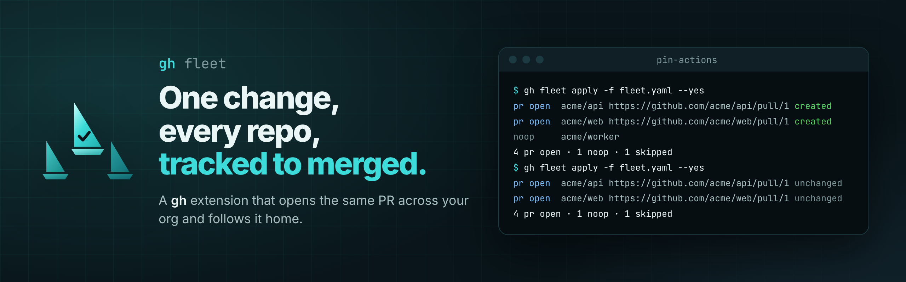

<p align="center">
  
</p>

<p align="center">
  <a href="https://github.com/rossedman/gh-fleet/actions/workflows/ci.yml"></a>
  <a href="https://github.com/rossedman/gh-fleet/blob/main/CONTRIBUTING.md#quality-bars"></a>
  <a href="https://goreportcard.com/report/github.com/rossedman/gh-fleet"></a>
  <a href="https://github.com/rossedman/gh-fleet/releases"></a>
  <a href="LICENSE"></a>
  <a href="https://rossedman.github.io/gh-fleet/"></a>
</p>

`gh fleet` is a [gh](https://cli.github.com/) extension that applies one change
across many repositories and tracks the pull requests to completion.

You describe the change once, as a **campaign**: which repos to target, what
to run in each, and how to open the PR. gh fleet clones each repo, runs your
script, pushes a branch, opens the PR, and reports every PR's checks and
reviews until it merges. Running the campaign again updates its PRs instead
of opening new ones.

## Install

```sh
gh extension install rossedman/gh-fleet
```

It uses your gh login (`gh auth login`) for the API and your own `git` for
clones and pushes, so credential helpers, commit signing and proxies work as
they do for you. If git doesn't already have GitHub credentials, run
`gh auth setup-git` once. Prebuilt binaries
for Linux, macOS and Windows (amd64 and arm64) are on the
[releases page](https://github.com/rossedman/gh-fleet/releases), with signed
checksums ([how to verify](SECURITY.md#verifying-releases)). To run from
source, clone the repo, `make build`, then `gh extension install .`.

## Quick start

```sh
gh fleet init pin-actions --org acme   # writes a commented fleet.yaml
$EDITOR fleet.yaml                     # targets, the change script, the PR
gh fleet targets                       # which repos match, and why
gh fleet plan --repo acme/api          # run it in one clone, show the diff
gh fleet plan                          # every repo: diffs, no-ops, failures
gh fleet apply                         # push branches, open PRs (asks first)
gh fleet status                        # PR state, checks and reviews
```

A campaign file:

```yaml
apiVersion: fleet.gh/v1
name: pin-actions
targets:
  orgs: [acme]
  include:
    files: [.github/workflows]   # path must exist
  exclude:
    topics: [no-fleet]
change:
  steps:                         # run in order in one clone
    - name: find refs
      starlark: ./change.star    # load("@fleet//gha.star", "unpinned")
    - name: resolve              # shell only where a tool is needed
      run: |
        set -e
        shas=""
        for ref in ${FLEET_VAR_REFS//,/ }; do
          shas="$shas $ref=$(gh api "repos/${ref%@*}/commits/${ref#*@}" --jq .sha)"
        done
        echo "shas=$shas" >> "$FLEET_OUTPUT/vars"
    - name: pin
      starlark: ./pin.star       # load("@fleet//gha.star", "pin")
pr:
  title: "ci: pin GitHub Actions to commit SHAs"
  body: ./pr-body.md             # a Go template with .Repo and .Campaign
  labels: [fleet, security]
limits:
  maxOpenPRs: 200
```

`gh fleet plan` on one repo:

```console
$ gh fleet plan --repo acme/api
── acme/api
diff --git a/.github/workflows/ci.yml b/.github/workflows/ci.yml
index e9179e8..4b6957d 100644
--- a/.github/workflows/ci.yml
+++ b/.github/workflows/ci.yml
@@ -1,5 +1,5 @@
 jobs:
   build:
     steps:
-      - uses: actions/checkout@v4
-      - uses: actions/setup-go@v5
+      - uses: actions/checkout@08eba0b27e820071cde6df949e0beb9ba4906955 # v4
+      - uses: actions/setup-go@0aaccfd150d50ccaeb58ebd88d36e91967a5f35b # v5

1 changed · 1 skipped
```

and `gh fleet status` once the PRs are open:

```console
$ gh fleet status
REPO            STATUS   PR                                      CHECKS   REVIEW           NOTE
acme/api        merged   https://github.com/acme/api/pull/1      success  approved
acme/billing    pr open  https://github.com/acme/billing/pull/1  success  approved
acme/docs-site  skipped  -                                       -        -                no push access
acme/gateway    pr open  https://github.com/acme/gateway/pull/1  failure  review required
acme/web        pr open  https://github.com/acme/web/pull/1      pending  review required
acme/worker     noop     -                                       -        -

3 pr open · 1 merged · 1 noop · 1 skipped
API quota: core 4,871/5,000 · graphql 4,962/5,000
```

[`examples/`](examples/) has fifty-one tested campaigns for the changes people
make most, each a few lines of Starlark: syncing standard files, find and
replace, README sections, security policies, Go, npm, Python, Cargo, Gradle, Maven,
.NET and Terraform dependency bumps, Docker, Compose and Helm image bumps,
runtime and runner versions, ruff and Renovate settings, Buildkite, GitLab CI,
CircleCI and Jenkins pipelines, Kustomize, Argo CD, Flux and Kubernetes manifests,
Terragrunt modules, changelogs, licenses, editor defaults,
action upgrades and SHA pinning, pre-commit hooks, Dependabot, CODEOWNERS,
`.gitignore` entries, read-only workflow tokens, and removing retired config.

## Commands

| Command | What it does |
| --- | --- |
| `gh fleet init [name]` | Scaffold a campaign file with commented defaults |
| `gh fleet targets` | Resolve and list the repos a campaign will touch, with the reason each matched |
| `gh fleet plan` | Clone, run the change, and show per-repo diffs without pushing |
| `gh fleet apply` | Run the change, push branches, open or update PRs |
| `gh fleet status` | Every target's PR link, state, checks, reviews and last error |
| `gh fleet retry` | Re-run only repos that failed or have no PR |
| `gh fleet close` | Close all open campaign PRs and delete their branches |
| `gh fleet exec -- <cmd>` | Run a read-only command across targets and tally the output |
| `gh fleet list` | List campaigns in local state |

Every command takes a campaign file (`--file`, default `./fleet.yaml`) or the
name of a campaign in local state. Read commands take `--json` and `--jq`.
Common flags: `--repo owner/name` (limit to some repos), `--concurrency N`,
`--yes`, `--keep-workdirs`, `--write-rate`.

## How it behaves

- **Idempotent.** PRs are found by branch (`fleet/<name>`) and by a hidden
  marker in their body, so re-running `apply` updates them, and `status` is
  right even if local state is deleted. Merged PRs are skipped; closed ones are
  left alone unless you pass `--reopen`.
- **Ordered steps, shell or Starlark.** A change is a list of steps run in
  order in one clone. Each is any shell script, or a sandboxed
  [Starlark](https://rossedman.github.io/gh-fleet/guides/starlark/) script
  that edits files through a `repo` object with no shell or network. A
  [built-in library](https://rossedman.github.io/gh-fleet/reference/starlark-library/)
  (`load("@fleet//gha.star", "bump_action")`) covers the common edits, and
  your own helpers can be shared from other repos by pinned commit.
- **Per-repo variables.** Give repos different values (owning team, on-call
  channel, target version) from defaults, match rules, a CSV, or the org's
  custom properties. They reach scripts as `FLEET_VAR_*` and PR text as
  `{{ .Vars.team }}`, and a missing one fails that repo before anything is
  pushed.
- **The script is the source of truth.** An existing campaign branch is
  rebased onto the base; on conflict it is reset and the script runs again.
- **One failure is one failure.** A repo whose script fails is recorded and the
  rest carry on; the exit code is non-zero at the end.
- **Kind to the API.** Writes go through one shared limiter (1 per second by
  default), a secondary rate limit pauses every worker until it passes, server
  errors are retried with backoff, and 10% of the primary quota is kept in
  reserve. Repo listings, file checks and PR lookups are batched GraphQL
  queries, 50 repos at a time.
- **Ctrl-C is safe.** The first one stops new repos from starting and lets
  in-flight scripts finish; state is saved. A second one exits immediately.

## Configuration

Flags can also come from environment variables (`GH_FLEET_CONCURRENCY`,
`GH_FLEET_WRITE_RATE`, ...) or a config file at
`$XDG_CONFIG_HOME/gh-fleet/config.yaml` (or `--config`). Precedence is
flag > environment > file. State lives in `$XDG_STATE_HOME/gh-fleet/`, with a
log per repo for every script run.

The full campaign file reference, guides and command reference are on the
[docs site](https://rossedman.github.io/gh-fleet/).

## Contributing

See [CONTRIBUTING.md](CONTRIBUTING.md). `make check` runs everything CI runs.
Security issues: [SECURITY.md](SECURITY.md).

## License

[Apache-2.0](LICENSE)
