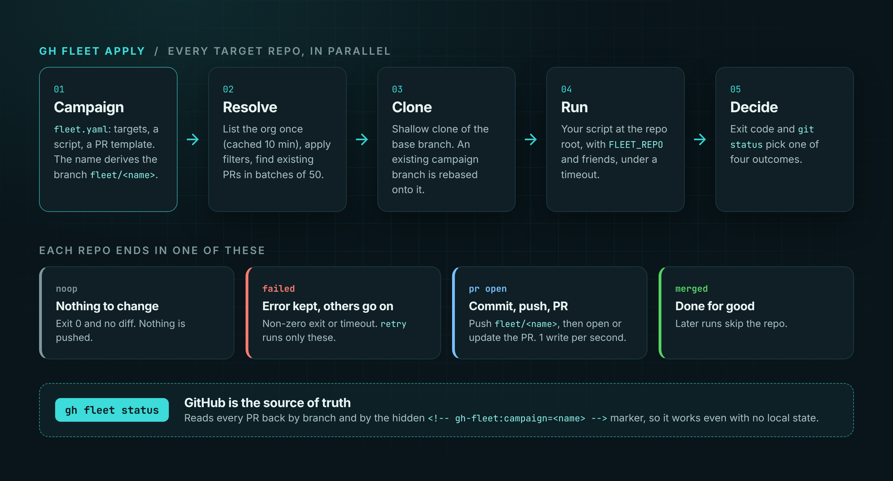

# How it works

Every target repo goes through the same short pipeline, and each repo can end in a different state without affecting the others.

<figure class="diagram" markdown>

</figure>

## The pipeline

1. **Resolve targets.** The campaign's `orgs` are listed 100 repos per page, 4 pages at a time (cached for 10 minutes), unless a code `search` has already named the only repos that can match. Cheap metadata filters run first, then `files` checks in batched queries of 50 repos, 4 at a time, split in half whenever GitHub times out. Exclusion always wins.
2. **Look up existing PRs.** For `apply`, gh fleet finds PRs by the head branch (`fleet/<name>`), in batched queries of 50 repos, and falls back to a search for the hidden `<!-- gh-fleet:campaign=<name> -->` marker in the PR body.
3. **Prepare a clone.** A shallow, blobless, single-branch clone of the base branch, with the campaign branch checked out. If the branch already exists on GitHub it is rebased onto the base; on a conflict it is reset to the base, because the script, not the old branch, is the source of truth.
4. **Run the script.** At the repo root, with the `FLEET_*` environment and a timeout. See [Writing changes](guides/writing-changes.md).
5. **Decide.** No difference from the base is a `noop`. A non-zero exit is `failed`. Otherwise the change is committed, pushed, and the PR is opened or updated.

## Where each repo ends up

| Status | Meaning |
| --- | --- |
| `pr open` | A PR exists and is open. Its detail says `created`, `unchanged` or what was updated. |
| `merged` | The PR was merged. Later runs skip the repo. |
| `closed` | The PR was closed without merging. Later runs leave it alone unless you pass `--reopen`. |
| `noop` | The script produced no difference from the base branch. |
| `changed` | The script made a change but it was not pushed, for example because `limits.maxOpenPRs` was reached. `retry` picks it up. |
| `failed` | The script, git or the API failed. The error is kept and `retry` runs the repo again. |
| `skipped` | The repo matched but you cannot push to it. |
| `pending` | Known to the campaign but not yet processed. |

## Source of truth

Local state under `$XDG_STATE_HOME/gh-fleet/` is a cache plus error history. `status` re-reads every PR from GitHub by branch and marker, so it stays correct if the state file is deleted, and a PR recorded locally that no longer exists on GitHub is reset to pending.
